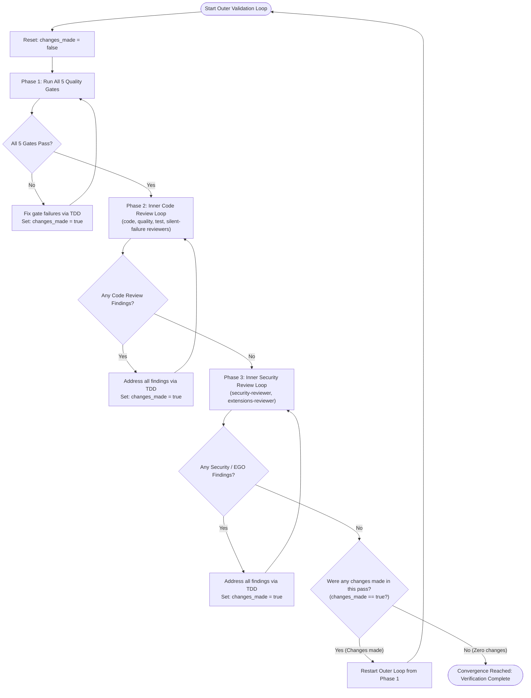

# Verification and Test Suite Validation Rules

These rules govern mandatory verification, test suite execution, code reviews, and quality gates that every agent **MUST** satisfy before considering any task, feature, bug fix, or refactoring complete.

> **Command names.** The `npm run …` scripts below are the project's target interface. They are introduced
> as the test harness (tests, Stryker, packaging) and quality tooling (ESLint, pre-commit) are built. Always
> read `package.json` for what exists _now_. If a gate's script does not exist yet, say so explicitly
> in your report instead of claiming the gate passed.

## 1. The Verification & Validation Meta-Loop Architecture

Validation is structured as an **Outer Convergence Loop** enclosing the 5 Quality Gates and **Two Inner Loops** (Code Review and Security Review).

An agent is only permitted to break out of the Outer Loop when an entire pass completes with **zero changes made** across all phases.

### The Convergence Protocol:

1. **Initialize Outer Iteration**: Track whether any files are modified during this outer loop pass (`changes_made = false`).
2. **Phase 1: Quality Gates Execution**: Run the 5 zero-tolerance quality gates. If code or tests must be updated to pass, mark `changes_made = true`.
3. **Phase 2: Inner Code Review Loop**: Delegate to the review agents (section 3). If findings exist, resolve them completely, mark `changes_made = true`, and re-review until zero findings remain.
4. **Phase 3: Inner Security / EGO Review Loop**: Delegate to `security-reviewer` and `extensions-reviewer` (section 4). If findings exist, resolve them completely, mark `changes_made = true`, and re-scan until zero findings remain.
5. **Phase 4: Outer Loop Convergence Decision**:
   - If `changes_made === true`: Code or tests were modified during gate resolution or review fixes. These changes may have introduced regressions, impacted coverage, or spawned mutants. **Restart the Outer Loop from Phase 1**.
   - If `changes_made === false`: All quality gates passed cleanly, every reviewer returned 0 findings on the initial scan without requiring any modifications. **Break out of the loop. Verification is complete.**

Sub-agents cannot spawn sub-agents, so the **main session runs this loop** and delegates each phase's work. See `.agents/README.md` for the roster and `.agents/protocols/handoff.md` for the report format.

---

## 2. Phase 1: Zero-Tolerance Quality Gates

Every change to production, test, or configuration code **MUST** pass all five quality gates with 100% compliance:

### Gate 1: Unit & Integration Tests (`npm test`)

- **Requirement**: The Vitest test suite (`vitest run`) must pass completely with **zero test failures**.
- **No Skipped Tests**: Existing tests must never be disabled, skipped (`it.skip`, `test.skip`, `describe.skip`, `.only`), or commented out to force a green test suite.
- **TDD Compliance**: Every new feature or bug fix must be preceded by a failing test that passes only after production code changes (per `tdd-rules.md`).
- **Integration tests** exercise the real modules together (and, where it matters, a real GJS runtime or the headless Shell in the devcontainer), with only the OS boundary mocked.

### Gate 2: Code Coverage Baseline (`npm run test:coverage`)

- **Requirement**: Code coverage must maintain a strict **100% baseline** across all metrics as configured in `vitest.config.*`:
  - **100% Statements**
  - **100% Branches**
  - **100% Functions**
  - **100% Lines**
- **No Coverage Drops**: Any new code paths, conditional branches (including error handling, edge cases, and default cases), or helper functions must have full test coverage.
- No `istanbul ignore` / `c8 ignore` / `v8 ignore` comments unless explicitly approved by the user.
- Data-only files (`data/*.js` emoji tables) are covered by data-integrity tests (shape, counts, uniqueness), not excluded.

### Gate 3: Mutation Testing & Zero Surviving Mutants (`npm run test:mutation`)

- **Requirement**: Stryker mutation testing (`stryker run`) must achieve a **100.00% Mutation Score** with **zero surviving mutants** (`Survived: 0`), **zero `NoCoverage`** and, ideally, **zero timeouts**.
- **Configuration Enforcement**: Stryker is configured with `thresholds.break: 100`. Any surviving mutant causes the build to fail.
- **Root Cause Resolution**: Surviving mutants indicate missing test assertions or redundant production code. Agents (the `mutation-killer` agent does this) must:
  1. Add precise, behavioral assertions that kill the mutant, OR
  2. Simplify/refactor the production code to eliminate untestable or unreachable redundant branches (applying the Transformation Priority Premise).
  3. Never suppress Stryker mutation checks using mutation comments (e.g. `// Stryker disable`), exclude files from `mutate`, or lower thresholds unless explicitly approved by the user.

### Gate 4: Static Analysis, Linter & Type Integrity (`npm run lint` & `npm run typecheck`)

- **Type Integrity**: The project is TypeScript (`strict`). `npm run typecheck` (`tsc --noEmit`) must complete with **0 errors**. No `any` escapes or suppressed diagnostics (`@ts-ignore`, `@ts-expect-error`) without an approved reason.
- **ESLint and formatting**: `npm run lint` (`eslint --max-warnings=0 .`) and `npm run format:check` (Prettier) must pass with **0 errors and 0 warnings**. No `eslint-disable`: ESLint itself rejects it, and the `no-suppressed-gates` pre-commit hook rejects skipped tests and coverage/mutation ignores.
- **Pre-commit Integrity**: `pre-commit run --all-files` must pass cleanly across all formatting and repository hygiene hooks (including ShellCheck and shfmt on shell scripts, codespell, and the checks above).

### Gate 5: GNOME Shell Package, EGO Review & Real-Shell Smoke Tests (`npm run build:package` & `shexli`)

- **Production Extension Package**: `npm run build:package` must execute cleanly:
  - Compiles the TypeScript with plain `tsc` (no bundler, no minifier, comments kept): extensions.gnome.org requires readable code
  - Compiles the GSettings schema (`glib-compile-schemas`) for local use, and **excludes** `gschemas.compiled` from the zip
  - Compiles all gettext `.po` catalogues to `.mo` (`msgfmt -c`)
  - Packages a valid zip bundle (`dist/emoji-selector@richardnpaul.github.com.zip`) containing only production files
- **EGO Review Validation**: `npm run shexli` (builds the zip, then runs `scripts/check-shexli.mjs`) must report **no findings: 0 errors and 0 warnings**, apart from the reviewed ones listed, each with its reason, in `scripts/lib/shexli-accepted.mjs` (an entry that no longer matches fails the check). **`shexli` exits 0 even when it reports warnings**, so the wrapper parses its JSON report and never trusts shexli's exit status, and it passes an **absolute** path (relative directory paths crash shexli 0.2.1).
- **Headless Preferences Smoke Tests**: Both LTR and RTL preferences rendering must pass:
  - `npm run test:prefs` (standard LTR preferences UI test)
  - `npm run test:prefs:rtl` (Right-To-Left mirrored preferences UI test)
- **Real-Shell Smoke Test**: `npm run test:shell` installs the built extension in the devcontainer's headless GNOME Shell 51 (see `.devcontainer/README.md`), enables and disables it twice, drives it with a virtual pointer and keyboard, and checks that it works with no errors in the Shell log and no leftover actors. It runs the Shell of the container only: 45 to 50 are verified against the Shell sources.

---

## 3. Phase 2: Inner Code Review Loop

The orchestrator **MUST** run these reviewers (in parallel where independent) against the change and iterate until all report **zero outstanding findings**:

| Reviewer agent          | Looks at                                                                                            |
| ----------------------- | --------------------------------------------------------------------------------------------------- |
| `code-reviewer`         | Correctness, readability & simplicity, architecture, performance (skill: `code-review-and-quality`) |
| `quality-reviewer`      | Dead code, duplication, complexity, tooling hygiene, types                                          |
| `test-reviewer`         | Assertion strength, coverage gaps, mock realism, mutation results                                   |
| `silent-failure-hunter` | Swallowed errors, partial-teardown, lost stack traces                                               |

1. **Review Execution**: Evaluate modified code across the five core dimensions:
   - **Correctness**: Spec conformance, boundary conditions, edge cases, error propagation.
   - **Readability & Simplicity**: Clear naming, clean control flow, no dead code, minimal cognitive complexity.
   - **Architecture**: Proper modular boundaries, clean dependency direction, no module-level shared mutable state.
   - **Security Hygiene**: Safe handling of settings, clipboard and data inputs.
   - **Performance**: No unbounded loops, no eager building of thousands of actors, clean memory management.
2. **Remediation**:
   - If findings are reported (any severity):
     - Address **every finding** with concrete code improvements (`tdd-red` → `tdd-green` → `tdd-refactor`; `mutation-killer` for mutants).
     - Follow TDD rules if behavioral or logic changes are required.
     - Mark `changes_made = true`.
     - Re-run the reviewers against the updated code.
   - A finding may be closed without a change only by showing it is a false positive, with evidence, in the report.
3. **Loop Termination**: Continue looping until the reviewers return **zero outstanding findings**.

---

## 4. Phase 3: Inner Security & EGO Review Loop

The orchestrator **MUST** run `security-reviewer` (skill: `security-review`) and `extensions-reviewer` (skills: `gnome-shell-extension-review-guidelines`, `gnome-shell-extension-best-practices`), plus `agent-content-auditor` whenever anything under `.agents/`, `.claude/`, `.devcontainer/` or `CLAUDE.md`/`AGENTS.md` changed or was imported:

1. **Audit Scope**: Inspect all modified files, touched components, and data paths:
   - **Dependency Audit**: Verify no vulnerable dependencies or risky pinned versions in `package.json`/lockfile; the extension itself ships zero runtime dependencies.
   - **Secrets & Sensitive Data**: Scan for exposed API keys, credentials, tokens, or logging of clipboard contents.
   - **GNOME Shell & GJS Security**:
     - Clipboard access only on explicit user action; disclosed in `metadata.json` description.
     - No process execution (`GLib.spawn_*`, `Gio.Subprocess`), no network, no file access beyond the extension directory. Any addition requires a security review and a stated reason.
     - Settings values validated before use as indexes, sizes or `style` fragments.
   - **Shell scripts**: `set -euo pipefail`, quoted expansions, no `rm` on unchecked variables.
   - **Supply chain**: pinned versions, pinned CI actions, no `curl | sh`, no committed build artefacts.
   - **EGO compliance**: lifecycle, signals, sources, forbidden imports, metadata, schema, packaging, `shexli` (0 errors, 0 warnings).
2. **Remediation**:
   - If findings are identified at any severity (CRITICAL, HIGH, MEDIUM, LOW, INFO):
     - Implement rigorous patches addressing the issue.
     - Add regression tests per `tdd-rules.md`.
     - Mark `changes_made = true`.
     - Re-run the review against the updated codebase.
3. **Loop Termination**: Continue looping until the reviews return **zero outstanding findings**.

---

## 5. Mandatory Verification Sequence Within Iterations

Within each iteration of the outer loop, agents **MUST** execute tasks in the following strict order:

1. **TDD Red-Green Cycle**: Run `npm test` during development to confirm failing and passing states.
2. **Type Checking, Lint & Formatting**: Run `npm run typecheck`, `npm run lint`, `npm run format:check` and `pre-commit run --all-files`.
3. **Full Coverage Verification**: Run `npm run test:coverage` to confirm that all 4 coverage dimensions remain at 100%.
4. **Production Package, Smoke Tests & Shexli**: Run `npm run build:package`, `npm run shexli`, `npm run test:prefs`, `npm run test:prefs:rtl` and `npm run test:shell` (`npm run test:real` runs the three; they are not part of `npm run check`, and CI runs them in their own job).
5. **Mutation Testing**: Run `npm run test:mutation` to prove complete mutant slaughter (100% score).
6. **Inner Code Review Loop**: Iterate until 0 findings remain.
7. **Inner Security & EGO Review Loop**: Iterate until 0 findings remain.
8. **Convergence Check**: Check if any changes were made; if yes, repeat from step 1.

---

## 6. Diagnostic Execution Guidelines

- **Scratch Scripts**: When diagnosing surviving mutants or analyzing review reports, agents **MUST** write analysis scripts to a scratch directory (not the repository) per `command-execution-rules.md` and execute them as single-line commands.
- **Incremental State**: Stryker uses `"incremental": true`. If cache anomalies or out-of-sync mutants are suspected, clear the specific mutant in the incremental file or clean `.stryker-tmp/` rather than disabling mutation rules.

---

## 7. Final Sign-Off and Reporting

An agent **MUST NOT** conclude a task, report completion, or request review without explicitly confirming that **the outer loop has converged with zero changes on its final pass**, and stating the verified status of all gates:

- **Convergence Status**: Outer loop completed with 0 changes made on the final iteration
- **Unit & Integration Tests**: Pass count / 100% green (0 failures)
- **Coverage**: Statements 100%, Branches 100%, Functions 100%, Lines 100%
- **Mutation Score**: 100.00% (0 surviving mutants, 0 no-coverage, timeouts reported)
- **Typecheck, Linter & Pre-commit**: 0 errors, 0 warnings
- **Production Package & EGO Review**: `dist/emoji-selector@richardnpaul.github.com.zip` and `shexli` clean (0 errors, 0 warnings)
- **Preferences & Real-Shell Smoke Tests**: LTR, RTL and headless-Shell passed
- **Code Review** (code, quality, test, silent-failure): 0 outstanding findings
- **Security & EGO Review** (security, extensions, agent-content when applicable): 0 outstanding findings

If any item could not be verified (script not yet created, tool unavailable), state it as **not verified** with the reason. Do not report it as passed.
